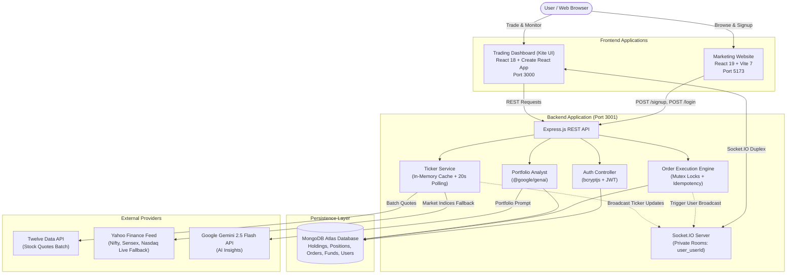

# Zerodha Trading Platform

An end-to-end, full-stack paper-trading ecosystem inspired by **Zerodha Kite**, featuring a marketing website, an interactive trading dashboard, and a server-authoritative backend API with real-time WebSockets, automated risk controls, and an AI-powered portfolio analyst.

---

> [!NOTE]
> **Educational & Paper-Trading Disclaimer**: This repository is an independent educational engineering project inspired by the Zerodha user experience. It is not affiliated with, endorsed by, or associated with Zerodha Broking Limited. All trading executions, portfolios, and funds are virtual simulations designed for educational paper-trading purposes.

---

## Table of Contents

- [Overview](#overview)
- [Key Features](#key-features)
  - [Trading Dashboard](#1-trading-dashboard)
  - [Authentication & Backend Engine](#2-authentication--backend-engine)
  - [Real-Time WebSocket Pipeline](#3-real-time-websocket-pipeline)
  - [AI Portfolio Analyst (Gemini)](#4-ai-portfolio-analyst-gemini)
  - [Marketing Website](#5-marketing-website)
- [System Architecture](#system-architecture)
- [Technology Stack](#technology-stack)
- [Repository Structure](#repository-structure)
- [Getting Started](#getting-started)
  - [Prerequisites](#prerequisites)
  - [Installation](#installation)
  - [Environment Variables](#environment-variables)
  - [Running the Applications](#running-the-applications)
- [End-to-End Workflows](#end-to-end-workflows)
  - [1. Authentication & Cross-Origin Handover](#1-authentication--cross-origin-handover)
  - [2. Market Data Flow & Rate-Limit Resilience](#2-market-data-flow--rate-limit-resilience)
  - [3. Order Placement, Concurrency Locking & Execution](#3-order-placement-concurrency-locking--execution)
  - [4. Limit Order Cancellation & Asset Un-reservation](#4-limit-order-cancellation--asset-un-reservation)
  - [5. AI Portfolio Diagnostics & Fallback](#5-ai-portfolio-diagnostics--fallback)
- [API Documentation](#api-documentation)
  - [Authentication Routes](#authentication-routes)
  - [Core Trading & Portfolio Routes](#core-trading--portfolio-routes)
  - [Funds Management Routes](#funds-management-routes)
  - [Market Data Routes](#market-data-routes)
  - [AI Analysis Route](#ai-analysis-route)
  - [WebSocket Events](#websocket-events)
- [Screenshots & UI Showcase](#screenshots--ui-showcase)
- [Testing & Quality Assurance](#testing--quality-assurance)
- [Security Safeguards & Limitations](#security-safeguards--limitations)
- [Project Roadmap](#project-roadmap)
- [Contributing & License](#contributing--license)

---

## Overview

The **Zerodha Trading Platform** is structured as a decoupled multi-app architecture replicating the complete trading workflow:

1. **Marketing & Auth Portal (`/frontend`)**: A client-facing web application built with React 19, Vite, and Bootstrap, featuring product showcases, pricing tables, educational resources, and customer onboarding.
2. **Trading Dashboard (`/dashboard`)**: A web trading terminal built with React 18, React Router, Material UI icons, and Chart.js, recreating Zerodha Kite's single-page interface with dual-market watchlists, interactive technical charts, Level 2 market depth, order placement windows, holdings, positions, and fund management.
3. **Backend Service (`/backend`)**: A Node.js and Express REST API and Socket.IO WebSocket server backed by MongoDB Atlas, enforcing server-authoritative order validation, margin accounting, race-condition serialization, live market data caching, and AI-driven portfolio insights.

---

## Key Features

### 1. Trading Dashboard
- **Dual-Market Watchlist**: Tab switching between **NIFTY 50** Indian equities and **NASDAQ 100** US equities with instant client-side filtering and visual distribution doughnut charts.
- **TopBar Indices Ticker**: Real-time ticker displaying **NIFTY 50**, **SENSEX**, and **NASDAQ (QQQ)** with positive/negative color highlights, percent changes, and live market open/closed status calculation (IST market hours).
- **Interactive Stock Analytics Modal**:
  - **Technical Charts**: Multi-timeframe views (`1D`, `1W`, `1M`, `1Y`, `ALL`) with Line and Candlestick modes, SMA (14) and EMA (20) overlays, and dynamic volume histogram bars.
  - **Level 2 Market Depth**: 5-level Bids vs. Asks order book with live buyer/seller distribution ratio bar.
  - **Fundamental Metrics**: 52-Week High/Low range slider, Market Capitalization, P/E ratio, EPS, Dividend Yield, Beta, and Circuit Limits.
- **Order Placement Window**:
  - Order modes: **BUY** and **SELL**.
  - Product types: **CNC** (Cash & Carry for long-term equity delivery) and **MIS** (Margin Intraday Square-off).
  - Order types: **MARKET** (instant execution) and **LIMIT** (pending execution at target price).
  - Automatic margin estimation and insufficient balance warnings before submission.
- **Holdings Management (`/holdings`)**: Delivery holdings view with total investment, current value, total P&L, day P&L, and vertical price distribution bars.
- **Positions Tracking (`/positions`)**: Intraday MIS trades with real-time Mark-to-Market (MTM) calculations and net change indicators.
- **Order Book (`/orders`)**: Comprehensive order history displaying execution status (`FILLED`, `PENDING`, `REJECTED`, `CANCELLED`), order timestamps, rejection reasons, and interactive cancellation for pending limit orders.
- **Funds Management (`/funds`)**: Equity margin summary (available cash, used margin, opening balance), instant UPI deposit modal (with quick presets from `+₹1,000` to `+₹50,000`), withdrawal request modal, and commodity segment status.
- **Partner Ecosystem (`/apps`)**: Clean partner integration directory showcasing Zerodha ecosystem platforms (**Smallcase**, **Sensibull**, **Streak**, **Tijori**, **Quicko**, **Zerodha Fund House**, **Varsity by Zerodha**, **GoldenPi**) with official brand logos and category filter pills.

### 2. Authentication & Backend Engine
- **Account Creation & Login**: Secure registration with unique email validation, bcrypt password hashing (salt rounds: 12), and JWT cookie issuance.
- **Server-Authoritative Order Validation**:
  - Validates positive integer quantities, valid numerical prices, and allowed order types.
  - Prevents short-selling on CNC holdings (ensures user actually owns the shares before placing a delivery sell).
  - Verifies available cash/margin before order acceptance; rejects orders with clear, descriptive error reasons.
- **Per-User Concurrency Mutex**: In-memory async lock (`acquireUserLock` / `releaseUserLock`) per user ID to serialize order processing, eliminating race conditions and double-spending across rapid concurrent requests.
- **Idempotency Protection**: In-memory TTL cache (60 seconds) combined with database-level idempotency key checks to safely ignore duplicate network submissions or rapid button clicks.
- **Dynamic Account Initialization**: New user accounts initialize cleanly with ₹0 balance, requiring explicit UPI deposit simulation before trading.

### 3. Real-Time WebSocket Pipeline
- **Socket.IO Duplex Server**: Mounted directly onto the Node.js HTTP server on port 3001.
- **Room-Based Isolation**: Authenticated clients automatically join isolated private rooms (`user_${userId}`) based on their JWT or session identifier.
- **Reactive State Distribution**: When an order is executed or cancelled, or funds are modified, the backend automatically triggers `broadcastUserUpdates(userId)`, broadcasting refreshed `holdings_update`, `positions_update`, `orders_update`, and `funds_update` events exclusively to that user.
- **Global Ticker Updates**: Market indices updates are broadcast to all connected clients on interval ticks without client polling fan-out.

### 4. AI Portfolio Analyst (Gemini)
- **Google Gemini Integration**: Built with the official `@google/genai` SDK using the `gemini-2.5-flash` model.
- **Deterministic Math + AI Insights**: Computes factual quantitative metrics server-side (total invested, current portfolio value, net P&L, percentage returns, top gainers, top losers, sector allocation percentages, cash buffer ratio) before feeding them into Gemini.
- **Structured Output**: Produces five distinct diagnostic categories:
  1. *Portfolio Overview*
  2. *Top Gainers & Losers Attribution*
  3. *Sector & Asset Concentration*
  4. *Cash Buffer & Risk Observations*
  5. *Actionable Guidance & Next Steps*
- **Offline / Graceful Fallback**: If `GEMINI_API_KEY` is not provided or API rate limits are encountered, an internal deterministic rule engine generates comprehensive portfolio diagnostics without failing the user request.

### 5. Marketing Website
- Multi-page responsive marketing portal built with React 19, Vite, and Bootstrap 5:
  - **Home (`/`)**: Hero section, trust ecosystem metrics, pricing highlights, and educational links.
  - **Products (`/productpage`)**: Showcase for Kite, Console, Coin, Kite Connect API, and Varsity Mobile.
  - **Pricing (`/pricing`)**: Detailed brokerage breakdown (₹0 equity delivery, ₹20 intraday and F&O trades).
  - **About (`/aboutpage`)**: Company background and executive leadership team.
  - **Support (`/supportpage`)**: Knowledgebase search, ticket topics, and customer service portal.
  - **Signup (`/signup`)**: Onboarding form with live validation and automatic redirect into the trading dashboard.

---

## System Architecture



### Architectural Highlights & Request Flow
1. **Client Interaction**: Users explore the platform via the marketing portal (`localhost:5173`) and sign up. Upon successful authentication, they are redirected to the trading dashboard (`localhost:3000`) with cross-origin session synchronization.
2. **Order Submission**: When a user submits an order on the dashboard, an HTTP `POST /newOrder` request is sent with an idempotency key.
3. **Mutex Serialization**: The backend acquires an in-memory lock for that specific user, performs validation against the user's funds and holdings in MongoDB, updates or creates positions/holdings, and releases the lock.
4. **WebSocket Push**: Immediately upon transaction completion, `broadcastUserUpdates` fires over Socket.IO, updating the user's open dashboard tabs without requiring manual page refreshes.
5. **Market Data Resiliency**: The background `TickerService` polls market data on a 20-second schedule, updates its in-memory cache, and emits ticker changes to all connected clients.

---

## Technology Stack

| Category | Technology | Version | Purpose / Implementation Details |
| :--- | :--- | :--- | :--- |
| **Frontend (Marketing)** | React | `19.2.0` | Declarative UI library for the marketing portal |
| | Vite | `7.2.4` | Next-generation build tool and dev server (`localhost:5173`) |
| | Bootstrap | `5.3.8` | Responsive layout grid and component styling |
| | React Router DOM | `7.15.1` | Client-side routing for marketing pages |
| | FontAwesome | `7.2.0` | Vector icons for UI elements and navigation |
| **Frontend (Dashboard)** | React | `18.2.0` | Core UI engine for the trading terminal |
| | React Scripts (CRA) | `5.0.1` | Build tooling and development server (`localhost:3000`) |
| | React Router DOM | `6.22.2` | Single-page application routing (`/`, `/orders`, `/holdings`, etc.) |
| | Material UI Icons | `5.18.0` | Kite-styled action and navigation icons |
| | Chart.js & React-Chartjs-2 | `4.4.2` / `5.2.0` | Portfolio doughnut charts and technical candlestick/line charts |
| | Socket.IO Client | `4.8.4` | Real-time WebSocket connection to the backend server |
| **Backend & API** | Node.js | `>= 18.0` | JavaScript runtime environment |
| | Express | `5.2.1` | Fast, unopinionated REST API framework |
| | Socket.IO | `4.8.4` | Full-duplex WebSocket communication with private user rooms |
| | HTTP & Body Parser | `2.3.0` | HTTP server mounting and request payload parsing |
| **Database & ODM** | MongoDB Atlas | Cloud | Scalable NoSQL cloud database storage |
| | Mongoose | `9.10.3` | Object Data Modeling (ODM) library for MongoDB |
| **Authentication & Security** | bcryptjs | `3.0.3` | Password hashing using 12 salt rounds |
| | jsonwebtoken (JWT) | `9.0.3` | Stateless signed token generation and route protection |
| | Cookie Parser | `1.4.7` | HTTP cookie extraction and parsing |
| | In-Memory Mutex | Native ES6 Map | Asynchronous concurrency lock per user ID |
| **External Integrations** | Twelve Data API | REST | Batch stock quote lookup for equity watchlists |
| | Yahoo Finance Chart API | Public HTTP | Live market index backup feed for NIFTY, SENSEX, and NASDAQ |
| | Google Gemini API | `@google/genai 2.28.0` | AI-powered quantitative portfolio diagnostics (`gemini-2.5-flash`) |

---

## Repository Structure

```
zerodha/
├── README.md                          # Root project documentation
├── package-lock.json                  # Root package lockfile
├── backend/                           # Node.js / Express REST API & WebSocket server
│   ├── .env                           # Environment variables (private, git-ignored)
│   ├── index.js                       # Primary server entrypoint, routes & Socket.IO mounting
│   ├── package.json                   # Backend dependencies and scripts
│   ├── controllers/
│   │   └── AuthController.js          # Signup, Login, and Logout logic
│   ├── middlewares/
│   │   └── AuthMiddleware.js          # JWT verification middleware
│   ├── model/                         # Mongoose model definitions
│   │   ├── FundsModel.js              # User equity & margin accounts
│   │   ├── HoldingsModel.js           # CNC long-term delivery holdings
│   │   ├── OrdersModel.js             # Order history and execution logs
│   │   ├── PositionsModel.js          # MIS intraday open positions
│   │   └── UserModel.js               # User accounts with hashed credentials
│   ├── schemas/                       # Mongoose database schemas
│   │   ├── FundsSchema.js
│   │   ├── HoldingsSchema.js
│   │   ├── OrdersSchema.js
│   │   ├── PositionsSchema.js
│   │   └── UserSchema.js
│   ├── services/                      # Core business logic services
│   │   ├── orderExecutionService.js   # Mutex locking, idempotency & order validation
│   │   ├── portfolioAnalystService.js # Math metrics & Gemini AI portfolio diagnostics
│   │   └── tickerService.js           # Twelve Data batch polling & resilient fallback
│   ├── tests/                         # Automated integration test suites
│   │   ├── enhancements.test.js       # Order engine, concurrency & WebSocket tests
│   │   └── qa_e2e_full_audit.test.js  # End-to-end multi-user integration & security test
│   ├── scripts/
│   │   └── clean_seeds.js             # Database cleanup utility
│   └── util/
│       └── SecretToken.js             # JWT token creation helper
├── dashboard/                         # Trading Terminal (Kite UI, React 18)
│   ├── package.json                   # Dashboard dependencies and scripts
│   ├── public/                        # Public assets & HTML template
│   │   ├── index.html                 # Main template with "Stock Broking Platform" title
│   │   └── media/images/              # Partner app logos (Smallcase, Sensibull, Quicko, etc.)
│   └── src/
│       ├── index.js                   # Dashboard React DOM root entrypoint
│       ├── index.css                  # Kite layout, table styles, and theme overrides
│       ├── components/
│       │   ├── AIPortfolioAnalystModal.js # Interactive AI modal with metric cards
│       │   ├── Apps.js                # Zerodha Universe partner apps directory
│       │   ├── BuyActionWindow.js     # Kite buy/sell popup with margin estimation
│       │   ├── Dashboard.js           # Main routing shell (Watchlist + Page Content)
│       │   ├── Funds.js               # Equity funds overview, UPI deposit & withdraw modals
│       │   ├── GeneralContext.js      # Global reactive state provider & Socket.IO listener
│       │   ├── Holdings.js            # CNC holdings table with P&L and metrics
│       │   ├── Home.js                # Session sync and top-level wrapper
│       │   ├── Menu.js                # Top navigation bar and user profile dropdown
│       │   ├── Orders.js              # Order book table with interactive limit cancellation
│       │   ├── Positions.js           # MIS intraday positions table with MTM
│       │   ├── StockAnalyticsModal.js # Technical charts, Level 2 depth & fundamentals
│       │   ├── Summary.js             # Account overview with equity stats & AI entry button
│       │   ├── TopBar.js              # Dynamic live index ticker (NIFTY, SENSEX, NASDAQ)
│       │   └── WatchList.js           # Searchable dual-tab watchlist (Nifty 50 & Nasdaq 100)
│       ├── data/
│       │   └── data.js                # Static stock datasets (50 NIFTY + 50 NASDAQ stocks)
│       └── services/
│           └── socketService.js       # Centralized Socket.IO client instance and event bus
└── frontend/                          # Marketing Website (React 19 + Vite)
    ├── package.json                   # Frontend dependencies and scripts
    ├── index.html                     # Vite HTML entrypoint with "Stock Broking Platform" title
    ├── vite.config.js                 # Vite bundler configuration
    ├── public/                        # Static marketing media
    │   └── media/images/              # Zerodha logos, illustrations, and partner badges
    └── src/
        ├── main.jsx                   # Vite React root & React Router configuration
        ├── App.jsx                    # Root marketing shell
        └── landing_page/              # Sectioned marketing components
            ├── Navbar.jsx             # Top branding navigation
            ├── Footer.jsx             # Global footer with disclaimers
            ├── home/                  # Landing page hero, pricing, and education
            ├── products/              # Kite, Console, Coin, and Universe partner platforms
            ├── pricing/               # Brokerage rates and charges calculator
            ├── about/                 # Company background and leadership
            ├── support/               # Portal ticket system and search
            └── signup/                # User registration form with instant redirect
```

---

## Getting Started

### Prerequisites
Before running the platform, ensure you have the following installed on your machine:
- **Node.js**: `v18.0.0` or higher (recommended: `v20.x` LTS)
- **npm**: `v9.0.0` or higher
- **MongoDB**: A free [MongoDB Atlas](https://www.mongodb.com/cloud/atlas) cluster connection URI or a local MongoDB instance running on `mongodb://localhost:27017/zerodha`.

---

### Installation

Clone the repository and install dependencies for all three packages:

```bash
# Clone the repository
git clone https://github.com/Antariksh62/Stock-Trading-Platform.git
cd Stock-Trading-Platform

# 1. Install Backend Dependencies
cd backend
npm install

# 2. Install Dashboard Dependencies
cd ../dashboard
npm install

# 3. Install Frontend Dependencies
cd ../frontend
npm install
```

---

### Environment Variables

The backend application requires configuration via an environment file. Create a `.env` file in the `backend/` directory:

```bash
# In the backend directory
touch .env
```

Add the following environment variable template to `backend/.env`:

```env
# Server Port Configuration
PORT=3001

# MongoDB Connection String (Atlas URI or local instance)
MONGO_URL=mongodb+srv://<USERNAME>:<PASSWORD>@<CLUSTER-URL>/<DATABASE-NAME>?retryWrites=true&w=majority

# JWT Token Secret for Auth Signatures
TOKEN_KEY=your_secure_jwt_secret_key_here

# External Market Data API Key (Twelve Data - Free Tier: 8 credits/min)
# Optional: If omitted or rate-limited, the backend automatically uses cached/fallback data.
TWELVE_DATA_API_KEY=your_twelve_data_api_key_here

# Google Gemini API Key for AI Portfolio Diagnostics
# Optional: If omitted or invalid, the backend uses a built-in deterministic rule engine.
GEMINI_API_KEY=your_gemini_api_key_here

# Graphify Knowledge Graph & Visual Chart Engine
# Optional: Path to knowledge graph artifacts and structural codebase mapping.
GRAPHIFY_ENABLED=true
GRAPHIFY_PATH=../graphify-out
```

> [!IMPORTANT]
> Neither the `frontend` nor `dashboard` applications require `.env` files for standard local development. They default automatically to `http://localhost:3001` for API requests and WebSockets. A ready-to-use template is also available at [`backend/.env.example`](file:///d:/Desktop/zerodha/backend/.env.example).

---

### Running the Applications

To run the full platform locally, open three separate terminal windows:

#### Terminal 1: Backend Service
```bash
cd backend
npm start
```
- Starts the Express REST API and Socket.IO server on **`http://localhost:3001`**.
- Verifies MongoDB connection (look for `Connected to MongoDB Atlas!` in the terminal).

#### Terminal 2: Trading Dashboard
```bash
cd dashboard
npm start
```
- Starts the trading interface on **`http://localhost:3000`**.
- Automatically opens your browser at `http://localhost:3000`.

#### Terminal 3: Marketing Website
```bash
cd frontend
npm run dev
```
- Starts the marketing portal on **`http://localhost:5173`**.
- Open your browser at `http://localhost:5173`.

---

## End-to-End Workflows

### 1. Authentication & Cross-Origin Handover
1. A user visits `http://localhost:5173/signup` and fills in their username, email, and password.
2. The frontend sends a `POST http://localhost:3001/signup` request.
3. The backend validates email uniqueness, hashes the password with bcrypt, creates the user record in MongoDB, and issues a JWT token.
4. The user is redirected to the trading dashboard (`http://localhost:3000/?token=<JWT>&user=<USER_JSON>`).
5. The dashboard's [`Home.js`](file:///d:/Desktop/zerodha/dashboard/src/components/Home.js) captures the query parameters, synchronizes them into `localStorage`, strips the tokens from the browser URL bar via `window.history.replaceState`, and initializes the authenticated trading session.

### 2. Market Data Flow & Rate-Limit Resilience
```
Twelve Data API (Every 20s) ──► TickerService (In-Memory Cache) ──► Socket.IO Broadcast
                                      │
              (Fallback if 429/Error) └──► Yahoo Finance Live Indices Chart
```
1. `tickerService.js` maintains a server-side timer running every 20 seconds (3 calls per minute, well below the free tier 8 credits/minute limit).
2. It requests a batch quote for major indices (`QQQ`, `NIFTY`, `SENSEX`).
3. If Twelve Data returns a rate-limit error (`429`) or daily quota exhaustion, the service automatically falls back to Yahoo Finance public chart endpoints (`^NSEI`, `^BSESN`, `^NDX`) to compute real-time index changes.
4. The cached result is emitted over Socket.IO (`ticker_update`) to all connected dashboard instances.

### 3. Order Placement, Concurrency Locking & Execution
1. The user clicks **BUY** or **SELL** on any stock in the Watchlist, opening [`BuyActionWindow.js`](file:///d:/Desktop/zerodha/dashboard/src/components/BuyActionWindow.js).
2. The user configures quantity, product (**CNC** delivery or **MIS** intraday), order type (**MARKET** or **LIMIT**), and clicks **Submit**.
3. A unique `idempotencyKey` is generated on the client and sent with the payload to `POST /newOrder`.
4. In `orderExecutionService.js`:
   - Checks the in-memory cache and MongoDB for the `idempotencyKey`. If already processed, returns the existing record immediately.
   - Acquires the per-user mutex lock (`acquireUserLock(userId)`).
   - Validates quantity, price, and checks user funds from `FundsModel`.
   - **For BUY**: Checks if `availableCash >= totalCost`. If insufficient, marks the order as `REJECTED` with a detailed reason. If sufficient, deducts virtual cash and margin. For `MARKET`, creates or averages the holding in `HoldingsModel` (for CNC) or `PositionsModel` (for MIS). For `LIMIT` where the limit price is below market, sets status to `PENDING`.
   - **For SELL**: If CNC, verifies that the user actually owns sufficient shares in `HoldingsModel`. If not owned, rejects the order. If owned, decrements/removes the holding and credits cash back to the user's funds.
   - Releases the mutex lock in a `finally` block.
5. Calls `broadcastUserUpdates(userId)` to push updated holdings, positions, orders, and funds directly to the user's browser over Socket.IO.

### 4. Limit Order Cancellation & Asset Un-reservation
1. A user navigates to the **Orders** tab (`/orders`) where pending limit orders display an interactive **Cancel** button.
2. Clicking Cancel sends a `POST /cancelOrder/:id` request.
3. The backend validates that the order is in `PENDING` status.
4. Changes the status to `CANCELLED` and automatically un-reserves the virtual funds previously committed to the order, restoring `availableCash` and `availableMargin`.
5. Emits real-time WebSocket updates to immediately update the Orders and Funds views.

### 5. AI Portfolio Diagnostics & Fallback
1. From the Dashboard Summary or Holdings page, the user clicks **✦ AI Portfolio Analyst**.
2. A request is sent to `POST /api/portfolio/analyze`.
3. In `portfolioAnalystService.js`:
   - Fetches the user's actual holdings and funds from MongoDB.
   - Computes deterministic metrics: total investment, current valuation, total P&L, P&L percentage, top gainers, top losers, sector weight breakdown, and liquid cash ratio.
   - If the user has 0 holdings, immediately returns an accurate empty-portfolio report without unnecessary external API calls.
   - If holdings exist and `GEMINI_API_KEY` is present, formats a structured prompt and queries Google Gemini (`gemini-2.5-flash`).
   - If Gemini is unreachable, times out, or no key is configured, an internal deterministic rule engine generates comprehensive, actionable portfolio analysis.
4. The dashboard renders the diagnostic report inside [`AIPortfolioAnalystModal.js`](file:///d:/Desktop/zerodha/dashboard/src/components/AIPortfolioAnalystModal.js) with metric badges, risk cards, and actionable suggestions.

---

## API Documentation

The backend service runs on `http://localhost:3001` and provides the following REST endpoints:

### Authentication Routes

#### `POST /signup`
- **Purpose**: Registers a new user account.
- **Auth Required**: No.
- **Request Body**:
  ```json
  {
    "username": "trader_jane",
    "email": "jane@example.com",
    "password": "SecurePassword123"
  }
  ```
- **Response Shape (`201 Created`)**:
  ```json
  {
    "message": "User signed up successfully",
    "success": true,
    "user": { "id": "670...", "username": "trader_jane", "email": "jane@example.com" },
    "token": "eyJhbGciOiJIUzI1NiIsInR5cCI6..."
  }
  ```
- **Error Cases**: `400` if required fields are missing or email is already registered; `500` on internal error.

#### `POST /login`
- **Purpose**: Authenticates an existing user and issues a JWT token.
- **Auth Required**: No.
- **Request Body**:
  ```json
  {
    "email": "jane@example.com",
    "password": "SecurePassword123"
  }
  ```
- **Response Shape (`200 OK`)**:
  ```json
  {
    "message": "User logged in successfully",
    "success": true,
    "user": { "id": "670...", "username": "trader_jane", "email": "jane@example.com" },
    "token": "eyJhbGciOiJIUzI1NiIsInR5cCI6..."
  }
  ```
- **Error Cases**: `400` for missing fields; `401` for incorrect credentials.

#### `POST /verify`
- **Purpose**: Verifies an active JWT session token.
- **Auth Required**: Yes (Bearer token in `Authorization` header or `token` cookie).
- **Response Shape (`200 OK`)**:
  ```json
  {
    "status": true,
    "user": "trader_jane",
    "userId": "670...",
    "email": "jane@example.com"
  }
  ```

---

### Core Trading & Portfolio Routes

#### `GET /allHoldings`
- **Purpose**: Retrieves all CNC equity delivery holdings for the authenticated user.
- **Auth Required**: Yes (or fallback to `userId` query parameter).
- **Response Shape (`200 OK`)**:
  ```json
  [
    {
      "_id": "670...",
      "userId": "670...",
      "name": "RELIANCE",
      "qty": 10,
      "avg": 2890.50,
      "price": 2890.50,
      "net": "+0.00%",
      "day": "+0.00%"
    }
  ]
  ```

#### `GET /allPositions`
- **Purpose**: Retrieves open MIS intraday positions for the authenticated user.
- **Auth Required**: Yes.
- **Response Shape (`200 OK`)**:
  ```json
  [
    {
      "_id": "670...",
      "userId": "670...",
      "name": "TCS",
      "qty": 5,
      "avg": 3950.20,
      "price": 3950.20,
      "product": "MIS",
      "net": "+0.00%",
      "day": "+0.00%",
      "isLoss": false
    }
  ]
  ```

#### `GET /allOrders`
- **Purpose**: Retrieves all orders placed by the user, sorted in descending order by creation date.
- **Auth Required**: Yes.
- **Response Shape (`200 OK`)**: Array of order objects including `status`, `rejectionReason`, `orderType`, `mode`, `product`, etc.

#### `POST /newOrder`
- **Purpose**: Places a buy or sell order with server-authoritative validation, mutex locking, and margin deduction.
- **Auth Required**: Yes.
- **Request Body**:
  ```json
  {
    "name": "INFY",
    "qty": 15,
    "price": 1540.75,
    "mode": "BUY",
    "product": "CNC",
    "orderType": "MARKET",
    "limitPrice": null,
    "idempotencyKey": "order_uuid_17288..."
  }
  ```
- **Response Shape (`201 Created`)**:
  ```json
  {
    "success": true,
    "status": "FILLED",
    "message": "Order FILLED: BUY 15 INFY @ ₹1540.75",
    "order": { "_id": "670...", "status": "FILLED", "name": "INFY", "qty": 15, "price": 1540.75 }
  }
  ```
- **Error Cases**: `400 Bad Request` if insufficient funds or holdings, or invalid parameters. Returns `{ "success": false, "status": "REJECTED", "message": "..." }`.

#### `POST /cancelOrder/:id` (also accepts `PUT`)
- **Purpose**: Cancels a pending limit order and releases reserved funds back to the user account.
- **Auth Required**: Yes.
- **Response Shape (`200 OK`)**:
  ```json
  {
    "success": true,
    "message": "Order #abc123 CANCELLED successfully",
    "order": { "_id": "670...", "status": "CANCELLED" }
  }
  ```

---

### Funds Management Routes

#### `GET /api/funds`
- **Purpose**: Retrieves the user's current equity margin balance and account funds.
- **Auth Required**: Yes.
- **Response Shape (`200 OK`)**:
  ```json
  {
    "userId": "670...",
    "availableMargin": 75000.00,
    "usedMargin": 25000.00,
    "availableCash": 75000.00,
    "openingBalance": 0.00,
    "payin": 100000.00,
    "span": 0.00,
    "deliveryMargin": 25000.00
  }
  ```

#### `POST /api/funds/add`
- **Purpose**: Simulates an instant UPI fund deposit.
- **Auth Required**: Yes.
- **Request Body**: `{ "amount": 25000 }`
- **Response Shape (`200 OK`)**:
  ```json
  {
    "success": true,
    "message": "₹25,000 added successfully via UPI",
    "funds": { "availableCash": 100000.00, "availableMargin": 100000.00, "payin": 100000.00 }
  }
  ```

#### `POST /api/funds/withdraw`
- **Purpose**: Simulates a fund withdrawal back to the user's bank account.
- **Auth Required**: Yes.
- **Request Body**: `{ "amount": 10000 }`
- **Response Shape (`200 OK`)**: `{ "success": true, "message": "Withdrawal request placed", "funds": { ... } }`

---

### Market Data Routes

#### `GET /api/indices`
- **Purpose**: Returns live market status (IST) and index quotes for NIFTY 50, SENSEX, and NASDAQ 100.
- **Auth Required**: No.
- **Response Shape (`200 OK`)**:
  ```json
  {
    "isMarketOpen": false,
    "lastUpdated": "2026-10-13T18:00:00.000Z",
    "indices": {
      "nifty": { "name": "NIFTY 50", "points": 22520.45, "percent": "+1.30%", "isDown": false },
      "sensex": { "name": "SENSEX", "points": 72472.33, "percent": "+1.23%", "isDown": false },
      "nasdaq": { "name": "NASDAQ 100", "points": 20883.15, "percent": "+0.51%", "isDown": false }
    }
  }
  ```

#### `GET /api/ticker`
- **Purpose**: Returns the latest cached market data from the background `TickerService`.
- **Auth Required**: No.

#### `GET /api/quotes?symbols=RELIANCE,TCS,INFY`
- **Purpose**: Returns batch stock quotes with in-memory caching and rate-limit guardrails.
- **Auth Required**: No.

---

### AI Analysis Route

#### `POST /api/portfolio/analyze`
- **Purpose**: Triggers quantitative calculations and Gemini AI diagnostic evaluation for the user's portfolio.
- **Auth Required**: Yes.
- **Response Shape (`200 OK`)**:
  ```json
  {
    "success": true,
    "source": "gemini-2.5-flash",
    "timestamp": "2026-10-13T18:00:00.000Z",
    "metrics": {
      "totalInvestment": 43250.00,
      "totalCurrentValue": 45120.00,
      "totalPnL": 1870.00,
      "pnlPercent": 4.32,
      "holdingsCount": 3,
      "availableCash": 56750.00,
      "cashRatioPercent": 55.71,
      "topHolding": { "name": "RELIANCE", "weightPercent": 48.2 },
      "sectorBreakdown": { "Energy & Conglomerate": 48.2, "Information Technology": 51.8 }
    },
    "analysis": {
      "overview": "Your portfolio demonstrates a healthy unrealized profit of +4.32%...",
      "topGainersLosers": "RELIANCE is leading gains (+₹1,240.00), while INFY is flat...",
      "concentrationAnalysis": "Significant concentration in IT and Energy sectors...",
      "riskObservations": "Strong liquidity buffer with 55.7% of total capital held in cash...",
      "actionableSuggestions": "Consider scaling into defensive consumer goods (FMCG) or banking..."
    },
    "disclaimer": "This AI-assisted portfolio review is generated for informational and paper-trading practice purposes only..."
  }
  ```

---

### WebSocket Events

The Socket.IO server communicates over WebSocket using the following events:

| Event Name | Direction | Payload Description |
| :--- | :--- | :--- |
| `connection` | Client ➔ Server | Client connects with `{ auth: { token, userId } }` and joins room `user_${userId}`. |
| `ticker_update` | Server ➔ All Clients | Global index ticker updates containing NIFTY, SENSEX, and NASDAQ live metrics. |
| `holdings_update` | Server ➔ User Room | Array of updated CNC holdings immediately after an order fill. |
| `positions_update`| Server ➔ User Room | Array of updated MIS intraday positions after an intraday order fill. |
| `orders_update` | Server ➔ User Room | Array of updated orders when an order is created, filled, or cancelled. |
| `funds_update` | Server ➔ User Room | Updated funds object reflecting margin changes, deposits, or order costs. |

---

## Screenshots & UI Showcase

The platform includes a collection of visual brand assets and UI illustrations stored within the repository:

| Feature Area | Asset Location | Visual Highlights |
| :--- | :--- | :--- |
| **Marketing Hero** | [`frontend/public/media/images/homeHero.svg`](file:///d:/Desktop/zerodha/frontend/public/media/images/homeHero.svg) | Clean vector graphic illustrating the Kite trading terminal experience |
| **Pricing Breakdown** | [`frontend/public/media/images/pricingEquity.svg`](file:///d:/Desktop/zerodha/frontend/public/media/images/pricingEquity.svg) | Visual breakdown of ₹0 free equity delivery and ₹20 intraday rates |
| **Zerodha Ecosystem** | [`frontend/public/media/images/ecosystem.png`](file:///d:/Desktop/zerodha/frontend/public/media/images/ecosystem.png) | Platform connectivity map across Kite, Console, Coin, and partner apps |
| **Partner App Logos** | [`dashboard/public/media/images/`](file:///d:/Desktop/zerodha/dashboard/public/media/images/) | Official SVGs and PNGs for Smallcase, Sensibull, Streak, Tijori, Quicko, and Fund House |

> [!TIP]
> **Adding Live Screenshots**: If you capture full-screen screenshots of your local running instance, place them in a newly created directory `docs/screenshots/` with the following suggested filenames:
> - `docs/screenshots/01-marketing-home.png` — Marketing Landing Page (`localhost:5173`)
> - `docs/screenshots/02-trading-dashboard.png` — Trading Terminal & Watchlist (`localhost:3000`)
> - `docs/screenshots/03-stock-analytics-modal.png` — Technical Charts & Level 2 Depth
> - `docs/screenshots/04-ai-portfolio-analyst.png` — Gemini AI Portfolio Analysis Modal
> - `docs/screenshots/05-funds-upi-deposit.png` — Virtual UPI Instant Deposit Modal

---

## Testing & Quality Assurance

### Automated Test Suites

The repository contains two automated test suites in the `backend/tests/` directory:

1. **Enhancements Test Suite (`backend/tests/enhancements.test.js`)**:
   - Tests order validation, insufficient funds rejection, CNC sell limits, limit order placement, limit order cancellation, per-user mutex concurrency serialization, Socket.IO updates, and Gemini AI portfolio analysis.
   - **How to Run**:
     ```bash
     # Ensure the backend server is running on port 3001, then in a new terminal:
     cd backend
     node tests/enhancements.test.js
     ```

2. **Comprehensive End-to-End QA Audit (`backend/tests/qa_e2e_full_audit.test.js`)**:
   - Simulates multi-user onboarding (User Alpha & User Beta), session isolation, cross-user authorization barriers, rapid concurrent order placement, and end-to-end P&L math.
   - **How to Run**:
     ```bash
     cd backend
     node tests/qa_e2e_full_audit.test.js
     ```

### Production Build Verification

Both front-end applications build cleanly for production deployment:

```bash
# 1. Verify Marketing Portal Production Build (Vite)
cd frontend
npm run build
# Expected Output: transforms modules and outputs dist/ with code 0

# 2. Verify Trading Dashboard Production Build (React Scripts)
cd ../dashboard
npm run build
# Expected Output: compiled successfully and outputs build/ with code 0
```

---

## Security Safeguards & Limitations

### Implemented Safeguards
- **Password Security**: Passwords are never stored in plaintext; hashed with bcrypt using 12 salt rounds.
- **Stateless Session Tokens**: JSON Web Tokens signed with a configurable server secret (`TOKEN_KEY`).
- **Race Condition Prevention**: Per-user async mutex serialization ensures that simultaneous orders cannot bypass balance checks.
- **Idempotency Protection**: Rapid duplicate submissions with the same key are caught in memory and in the database.
- **Server-Authoritative Margin**: The client cannot dictate margin deductions or prices; the backend computes required cash and validates against the database.
- **AI Graceful Fallback**: If external AI APIs fail or rate limits are exceeded, an internal deterministic rule engine ensures zero application crashes.

### Current Limitations
- **Paper Trading Only**: This application is not integrated with the National Stock Exchange of India (NSE), Bombay Stock Exchange (BSE), or SEBI-registered depositories (CDSL/NSDL).
- **Simulated Order Matching**: Market orders fill instantaneously at quoted prices; limit orders match based on synthetic quote triggers rather than an exchange matching engine.
- **Third-Party API Quotas**: The free tier of Twelve Data API allows 8 credits/minute and 800 credits/day. The application gracefully degrades to cached data and Yahoo Finance when quotas are exceeded.
- **AI Financial Disclaimer**: AI-generated portfolio diagnostics are intended strictly for educational practice and algorithmic simulation. They do not constitute certified financial or investment advice.

---

## Project Roadmap

### Implemented Features
- [x] Full Zerodha Kite-style trading dashboard UI with dual watchlists (NIFTY 50 & NASDAQ 100).
- [x] Level 2 market depth order book and multi-timeframe technical charts (SMA, EMA, Volume).
- [x] Complete order execution engine with MARKET / LIMIT and CNC / MIS product types.
- [x] Server-authoritative virtual funds management with UPI deposit and withdrawal simulation.
- [x] Real-time bi-directional WebSocket state distribution via Socket.IO.
- [x] Gemini 2.5 Flash AI Portfolio Analyst with deterministic rule fallback.
- [x] Multi-page responsive marketing website with user registration and login.
- [x] Full brand partner showcase (Smallcase, Sensibull, Quicko, Tijori, Streak, etc.) with official logos.

---


### License
This project is open-source and distributed under the **ISC License**. See the `package.json` manifests for details.

---

*Developed with passion as a comprehensive study of high-performance fintech architecture, real-time trading systems, and modern full-stack web development.*
